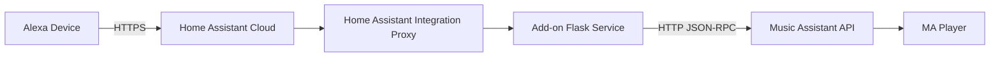

# Music Assistant Alexa Voice Skill

Voice-control [Music Assistant](https://music-assistant.io) from Alexa. This skill searches your MA library/providers and starts playback on your existing MA players (Satellite, RackPi, Sonos, etc.).

## Home Assistant add-on (recommended)

This repository is a Home Assistant add-on repository. Install it directly in Supervisor:

1. **Settings → Add-ons → Add-on Store → ⋮ → Custom repositories**
2. Add: `https://github.com/sickkick/music-assistant-alexa-voice`
3. Install **Music Assistant Alexa Voice**
4. Configure `ma_token`, `default_player_id`, and verify `ma_url`
5. Start the add-on and open **Open Web UI** to test `/players`

See [music_assistant_alexa_voice/DOCS.md](music_assistant_alexa_voice/DOCS.md) for full add-on setup and troubleshooting.

## Home Assistant Cloud (recommended for Alexa)

Use **Home Assistant Cloud (Nabu Casa)** for external access — no reverse proxy or port forwarding required.

1. Enable **Settings → Home Assistant Cloud → Remote Access**
2. Install the custom integration from `custom_components/music_assistant_alexa_voice` (HACS or manual copy)
3. Add the integration and set:
   - **Add-on URL:** `http://music_assistant_alexa_voice:5000`
   - **Cloud access token:** a long random secret
4. Use this Alexa skill endpoint:

```text
https://YOUR_ID.ui.nabu.casa/api/music_assistant_alexa_voice/alexa?token=YOUR_CLOUD_ACCESS_TOKEN
```

Full setup details: [music_assistant_alexa_voice/DOCS.md](music_assistant_alexa_voice/DOCS.md)

## Example utterances

- "Alexa, open music assistant"
- "Alexa, ask music assistant to play Fleetwood Mac"
- "Alexa, ask music assistant to play jazz in the kitchen"
- "Alexa, ask music assistant to pause"
- "Alexa, ask music assistant to skip"

## Architecture



## Standalone Docker

You can also run outside Home Assistant:

```bash
cp .env.example .env
docker compose up -d --build
curl http://localhost:5055/health
```

Edit `.env`:

| Variable | Description |
|---|---|
| `MA_URL` | Music Assistant base URL, e.g. `http://192.168.1.10:8095` |
| `MA_TOKEN` | MA API bearer token |
| `DEFAULT_PLAYER_ID` | Player ID to use when no room is specified |
| `PLAYER_ALIASES` | Optional JSON map of friendly names → player IDs |

## Alternative: self-hosted HTTPS

If you are not using Home Assistant Cloud, expose the add-on or standalone Docker service with your own reverse proxy:

```text
https://alexa-voice.example.com/alexa
```

## Create the Alexa skill

1. Open the [Alexa Developer Console](https://developer.amazon.com/alexa/console/ask)
2. **Create Skill** → Custom → Provision your own
3. Import `music_assistant_alexa_voice/skill/interaction-model/en-US.json`
4. Invocation name: `music assistant`
5. Endpoint: your Home Assistant Cloud URL or self-hosted HTTPS URL

## Supported commands

| Voice command | MA API action |
|---|---|
| play {query} | `music/search` → `player_queues/play_media` |
| play {query} in {room} | resolves player → play |
| pause | `player_queues/pause` |
| resume | `player_queues/play` |
| stop / cancel | `player_queues/stop` |
| next / skip | `player_queues/next` |
| previous / go back | `player_queues/previous` |

## Project layout

```text
repository.yaml
music_assistant_alexa_voice/     Home Assistant add-on
custom_components/
  music_assistant_alexa_voice/     HA Cloud proxy integration
hacs.json
docker-compose.yml                 Standalone Docker option
```

## Notes

- This skill controls MA players directly. It does **not** stream audio to the Echo speaker itself.
- For Echo-as-speaker streaming, see the official [Music Assistant Alexa player docs](https://www.music-assistant.io/player-support/alexa/).
